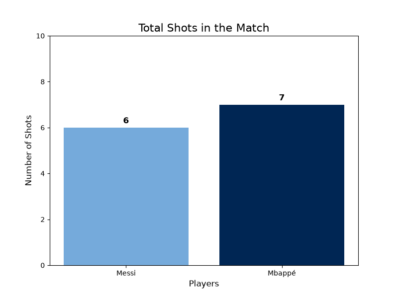

# ⚽ Player Performance Comparison - Football Analytics

مشروع لتحليل بيانات كرة القدم ومقارنة أداء اللاعبين باستخدام لغة Python وبيانات StatsBomb الحقيقية.

## 📌 فكرة المشروع (Project Overview)
تم بناء هذا المشروع لتحليل مباراة نهائي كأس العالم 2022 (الأرجنتين ضد فرنسا)، ومقارنة أداء الأسطورة ليونيل ميسي وكيليان مبابي باستخدام البيانات الإحصائية. يتضمن المشروع تحليلاً للبيانات، ورسوماً بيانية، ولوحة تحكم تفاعلية (Dashboard).

## 🛠️ التقنيات المستخدمة (Tech Stack)
*   **Python** (لغة البرمجة الأساسية)
*   **Pandas** (لمعالجة البيانات وتنظيفها)
*   **Matplotlib & Seaborn** (لرسم المخططات البيانية)
*   **mplsoccer** (لرسم ملاعب كرة القدم والخرائط الحرارية)
*   **Streamlit** (لبناء لوحة التحكم التفاعلية)

## 🚀 المميزات (Features)
*   تحميل بيانات حقيقية من StatsBomb Open Data.
*   استخراج إحصائيات دقيقة (تسديدات، تمريرات، إلخ).
*   رسم خرائط حرارية (Heatmaps) توضح مناطق تواجد اللاعبين.
*   واجهة مستخدم تفاعلية تتيح اختيار أي لاعب من المباراة ومقارنته بلاعب آخر.

## 📂 هيكل المشروع (Project Structure)
*   `load_data.py`: سكريبت لتحميل البيانات واستكشافها.
*   `analysis.ipynb`: دفتر Jupyter يحتوي على التحليل والرسوم البيانية.
*   `dashboard.py`: كود لوحة التحكم التفاعلية (Streamlit).
*   `README.md`: هذا الملف التوثيقي.

## ⚙️ كيفية التشغيل (How to Run)
1. قم بتثبيت المكتبات المطلوبة:
   ```bash
   pip install pandas matplotlib mplsoccer streamlit
   
